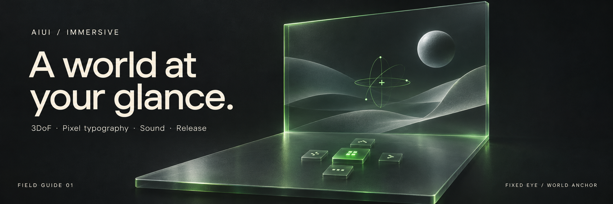

<p align="center"></p>

<p align="center"><strong>English</strong> · <a href="README.zh-CN.md">简体中文</a> · <a href="README.zh-TW.md">繁體中文</a></p>
<p align="center">
  
  
  
  
</p>

# AIUI Immersive 3DoF

**Build a world that stays put when you look around.**

A reusable agent skill for taking a Rokid AIUI experience from spatial design to a verified release candidate: head tracking, temple controls, CJK pixel typography, Blender assets, synchronized sound and video, device evidence, and Studio delivery.

Distilled from an actual fixed-eye music-toy project. Designed for the next immersive scene, not only that toy.

---

### One workflow. Three disciplines.

| Spatial craft | Native interaction | Credible delivery |
| --- | --- | --- |
| World anchoring, full-pose recenter, horizontal surfaces, shared draw/hit geometry | Fresh IMU samples, swipe-only menus, hold-release suppression, lifecycle cleanup | Actual sound, deterministic timelines, device checks, versioned uploads and observed release states |

The skill distinguishes a baked fixed-eye scene from real-time meshes; a simulated film from device capture; and a saved draft from a live store release. Those distinctions are part of the craft.

### Install

Access to this private repository is required. With GitHub CLI authenticated:

```sh
mkdir -p "${CODEX_HOME:-$HOME/.codex}/skills"
gh repo clone EazyLee30/aiui-immersive-3dof \
  "${CODEX_HOME:-$HOME/.codex}/skills/aiui-immersive-3dof"
```

Then invoke the skill in a new Codex conversation:

```text
Use $aiui-immersive-3dof to build an immersive AIUI scene.
Keep the scene world-anchored, use a horizontal control surface below it,
and prepare a sound-synchronized demonstration and an AIUI draft.
```

Automatic discovery is enabled. In another compatible agent, place this repository in its skill directory or explicitly provide [SKILL.md](SKILL.md). The skill does not require one browser automation vendor; it follows the tool available in that environment.

### Start from something concrete

```sh
SKILL_DIR="${CODEX_HOME:-$HOME/.codex}/skills/aiui-immersive-3dof"
python3 "$SKILL_DIR/scripts/init_project.py" ./my-spatial-scene \
  --name "My Spatial Scene"
```

The initializer creates a fresh AIUI source directory with a forward portal, a genuinely horizontal pad, full-pose calibration, a swipe-only menu and a bundled OFL pixel font. It refuses to overwrite an existing directory. The 480×352 monochrome profile is a reference configuration; adapt it to the actual target.

It does not install packages, touch a device, create a cloud agent or publish an app. The starter contains no finished character art, music engine or persistence claim.

Add `--font-locale zh-TW` for Taiwan Traditional-Chinese glyph forms; the default is `zh-CN`. This selects a font, not an automatic translation. Both full fonts include the tested Simplified/Traditional specimen; each is about 5.1 MB. See [font provenance](docs/font-provenance.json).

### The field guide

| Stage | What you get |
| --- | --- |
| **01 — Define the world** | [Runtime contract](references/runtime-contract.md) · [Spatial design](references/spatial-design.md) |
| **02 — Own the input** | [IMU, temple gestures and lifecycle](references/input-lifecycle.md) |
| **03 — Shape the image** | [Blender baking, CJK typography and alpha-safe icons](references/art-and-typography.md) |
| **04 — Make it audible** | [Device capture, offline rendering and sound synchronization](references/audio-and-video.md) |
| **05 — Prove the behavior** | [ADB and device verification](references/device-verification.md) · [Field notes](references/field-notes.md) |
| **06 — Deliver deliberately** | [Studio upload, review and release](references/aiui-release.md) |

### Tools worth keeping

| File | Purpose |
| --- | --- |
| [SKILL.md](SKILL.md) | Compact entrypoint with progressive reference loading |
| [assets/starter](assets/starter) | Native `.ink` reference, spatial math and input state machine |
| [init_project.py](scripts/init_project.py) | Create a new project without overwriting work |
| [asset_manifest.py](scripts/asset_manifest.py) | Deterministic file-size/SHA-256 inventory with cache exclusions |
| [inspect_media.mjs](scripts/inspect_media.mjs) | Detect missing/silent audio, duration mismatch and decoded peak clipping |
| [assets/templates](assets/templates) | Bake metadata, evidence and release-state records |
| [tests](tests) | Behavioral checks for geometry, menus, gestures and portable helpers |

### Verify before you claim

Node.js 20+ and Python 3 are sufficient for the repository checks. FFmpeg/ffprobe are needed for media inspection. Blender, ADB and the official AIX CLI are used only by their relevant workflows; they are not silently installed.

```sh
npm test
npm run check
node scripts/inspect_media.mjs /path/to/demo.mp4 --require-audio
```

The last command intentionally fails for a silent film or an absent audio track. Stream checks cannot replace listening or prove perceptual synchronization. See the [verification record](docs/verification.md) for what this repository actually exercised.

The documented publication path covers submission, review and going live. The originating case reached a saved cloud draft, not a verified store listing. The skill carries that boundary forward and performs only the state requested by the user.

### Scope and provenance

This is an independent workflow for Rokid AIUI, not an official Rokid product or certification. It does not promise 6DoF, stereo depth, stable device FPS, unverified storage, or a future hardware release date.

No source-project character models, scene textures, music samples, private screenshots, device serials, account IDs or credentials are bundled. The included [Fusion Pixel font](https://github.com/TakWolf/fusion-pixel-font) keeps its [OFL 1.1 license](assets/starter/assets/fonts/FusionPixel-OFL.txt). Original repository content is private; see [LICENSE](LICENSE). The cover is original AI-generated editorial artwork; its [design record](docs/design.md) includes the prompt and visual system.

<sub>Fixed eye. Clear controls. Honest evidence.</sub>
