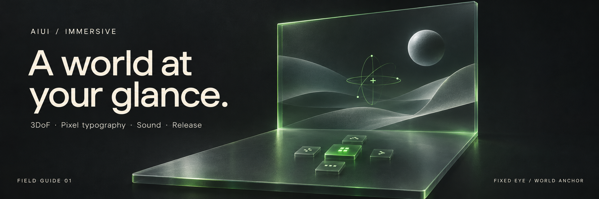
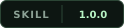

<p align="center"></p>

<p align="center"><a href="README.md">English</a> · <strong>简体中文</strong> · <a href="README.zh-TW.md">繁體中文</a></p>
<p align="center">
  
  
  
  
</p>

# AIUI 沉浸式 3DoF

**你转头，世界留在原处。**

一套可复用的 agent skill，贯通 Rokid AIUI 的空间设计、IMU 头控、镜腿交互、中文像素字体、Blender 素材、有声演示、真机验证与平台交付。

从真实音乐玩具项目中提炼，面向下一款沉浸式作品，而不限定于音乐玩具。

---

### 一条流程，三种功夫

| 空间设计 | 原生交互 | 有据可查的交付 |
| --- | --- | --- |
| 世界锚定、完整姿态回中、水平操作面、绘制与命中共用几何 | 新鲜 IMU 样本、只靠滑动选择的菜单、长按释放抑制、生命周期清理 | 真实声音、确定性时间线、真机证据、版本化上传与实际发布状态 |

明确区分烘焙场景和实时网格、模拟影片和设备实录、保存草稿和正式上架。这些区分本身就是制作质量的一部分。

### 安装

需要拥有此私有仓库的访问权限。登录 GitHub CLI 后执行：

```sh
mkdir -p "${CODEX_HOME:-$HOME/.codex}/skills"
gh repo clone EazyLee30/aiui-immersive-3dof \
  "${CODEX_HOME:-$HOME/.codex}/skills/aiui-immersive-3dof"
```

在新的 Codex 会话里调用：

```text
用 $aiui-immersive-3dof 做一个沉浸式 AIUI 场景。
场景保持世界锚定，下方是水平操作台，
制作音画同步的演示视频，并上传成 AIUI 草稿。
```

默认支持自动发现。其他兼容 agent 可将仓库放入自己的 skill 目录，或显式读取 [SKILL.md](SKILL.md)。不绑定某一种浏览器自动化工具，按实际环境中的工具完成操作。

### 从可运行的结构开始

```sh
SKILL_DIR="${CODEX_HOME:-$HOME/.codex}/skills/aiui-immersive-3dof"
python3 "$SKILL_DIR/scripts/init_project.py" ./my-spatial-scene \
  --name "我的空间场景"
```

初始化器生成新的 AIUI 源码目录，包含正前方场景、真正水平的 Pad、完整姿态校准、仅滑动选择的菜单、附带 OFL 许可的像素字体、按投影自适应并随面板旋转的文字，以及可选的双槽存档。目标目录已存在时会停止，避免覆盖工作。480×352 单绿配置是参考值，需要按实际设备调整。

初始化不会安装依赖、操作眼镜、创建云端智能体或发布应用。起始工程带一个经校验的双槽存档模块；成品人物、音乐引擎和业务存档字段仍由项目自行实现。

添加 `--font-locale zh-TW` 可选择台湾繁体字形，默认使用 `zh-CN`。这个选项选择字体，不会自动翻译界面。两套完整字体均通过简繁字符样本检查，每套约 5.1 MB，来源与校验值见 [字体记录](docs/font-provenance.json)。

### 制作手册

| 阶段 | 内容 |
| --- | --- |
| **00 — 搭好外壳** | [应用框架：模块边界、契约与单帧流程](references/framework.md) |
| **01 — 定义空间** | [运行时约定](references/runtime-contract.md) · [空间设计](references/spatial-design.md) |
| **02 — 分配交互** | [IMU、镜腿手势与生命周期](references/input-lifecycle.md) |
| **03 — 打磨画面** | [Blender 烘焙、中文像素字与透明图标](references/art-and-typography.md) |
| **04 — 让声音同步** | [真机录制、离线渲染与音画同步](references/audio-and-video.md) |
| **05 — 验证行为** | [原生内存、换景与音频优化](references/native-performance.md) · [ADB 真机验收](references/device-verification.md) · [实测经验](references/field-notes.md) |
| **06 — 完成交付** | [Studio 上传、提审与发布](references/aiui-release.md) |

### 保留完整体验，约束资源增长

新增[原生性能手册](references/native-performance.md)，沉淀 USB 真机验证过的有限图片池、共享几何、固定内存 Worker 合成、实际 PCM 预充和生命周期清理。明确区分图片估算与原生内存、应用计数与音频出口欠载，以及缓冲连续性与操作延迟。[性能记录模板](assets/templates/performance-evidence.json)保留测量口径与未知项。数值是调参案例；起始工程不附带原项目音乐引擎。

### 可以直接复用的工具

| 文件 | 用途 |
| --- | --- |
| [SKILL.md](SKILL.md) | 精简入口，按任务加载需要的参考文档 |
| [assets/starter](assets/starter) | 原生 `.ink` 示例、空间数学与输入状态机 |
| [init_project.py](scripts/init_project.py) | 创建新项目，不覆盖已有工作 |
| [asset_manifest.py](scripts/asset_manifest.py) | 生成文件大小与 SHA-256 清单，排除缓存 |
| [inspect_media.mjs](scripts/inspect_media.mjs) | 检查无音轨、全静音、音画时长差与解码峰值 |
| [assets/templates](assets/templates) | 烘焙参数、验收证据与发布记录模板 |
| [tests](tests) | 几何、菜单、手势和辅助脚本的行为验证 |

### 验证以后，再写结论

仓库检查只需要 Node.js 20+ 和 Python 3；检查视频另需 FFmpeg/ffprobe。Blender、ADB、官方 AIX CLI 仅在对应流程使用，不会被脚本静默安装。

```sh
npm test
npm run check
node scripts/inspect_media.mjs /path/to/demo.mp4 --require-audio
```

最后一条命令会拒绝没有音轨或全静音的视频。流信息与峰值检查不能代替试听，也不能单独证明感知上的音画同步。具体执行结果见 [验证记录](docs/verification.md)。

发布说明覆盖提交审核、等待审核和正式上线。原项目最近一次更新把优化包保存到既有智能体的调试版，旧商店版保持已上架。上传与发布仍是不同状态；通用起始工程不因此获得商店发布或真机性能保证。

### 范围与来源

这是独立的 Rokid AIUI 工作流程，不是 Rokid 官方产品或认证。不承诺 6DoF、双目立体、稳定真机帧率、未经验证的存档能力或未来硬件发布日期。

仓库不包含原项目人物模型、场景贴图、音乐采样、私人截图、设备序列号、账号 ID 或凭据。随附的 [Fusion Pixel 字体](https://github.com/TakWolf/fusion-pixel-font) 保留 [OFL 1.1 许可](assets/starter/assets/fonts/FusionPixel-OFL.txt)。原创仓库内容保持私有，见 [LICENSE](LICENSE)。封面为原创 AI 生成的编辑视觉，提示词与设计系统见 [设计记录](docs/design.md)。

<sub>固定眼位。清晰交互。真实证据。</sub>
