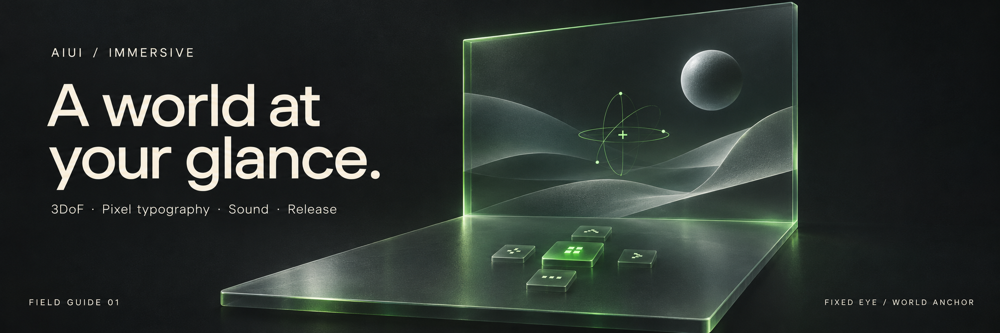
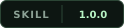

<p align="center"></p>

<p align="center"><a href="README.md">English</a> · <a href="README.zh-CN.md">简体中文</a> · <strong>繁體中文</strong></p>
<p align="center">
  
  
  
  
</p>

# AIUI 沉浸式 3DoF

**你轉頭，世界留在原處。**

一套可重複使用的 agent skill，串接 Rokid AIUI 的空間設計、IMU 頭部控制、鏡腿互動、中文像素字型、Blender 素材、有聲示範、實機驗證與平台交付。

從實際音樂玩具專案中提煉，面向下一款沉浸式作品，不限定於音樂玩具。

---

### 一條流程，三種功夫

| 空間設計 | 原生互動 | 有據可查的交付 |
| --- | --- | --- |
| 世界錨定、完整姿態重新置中、水平操作面、繪製與命中共用幾何 | 即時 IMU 樣本、僅靠滑動選擇的選單、長按釋放抑制、生命週期清理 | 實際聲音、確定性時間軸、實機證據、版本化上傳與實際發布狀態 |

明確區分烘焙場景與即時網格、模擬影片與裝置實錄、儲存草稿與正式上架。這些區分本身就是製作品質的一部分。

### 安裝

需要擁有此私人儲存庫的存取權限。登入 GitHub CLI 後執行：

```sh
mkdir -p "${CODEX_HOME:-$HOME/.codex}/skills"
gh repo clone EazyLee30/aiui-immersive-3dof \
  "${CODEX_HOME:-$HOME/.codex}/skills/aiui-immersive-3dof"
```

在新的 Codex 對話中呼叫：

```text
用 $aiui-immersive-3dof 製作一個沉浸式 AIUI 場景。
場景保持世界錨定，下方是水平操作台，
製作聲畫同步的示範影片，並上傳為 AIUI 草稿。
```

預設支援自動發現。其他相容 agent 可將儲存庫放入自己的 skill 目錄，或明確讀取 [SKILL.md](SKILL.md)。不綁定特定瀏覽器自動化工具，依實際環境中的工具完成操作。

### 從可執行的結構開始

```sh
SKILL_DIR="${CODEX_HOME:-$HOME/.codex}/skills/aiui-immersive-3dof"
python3 "$SKILL_DIR/scripts/init_project.py" ./my-spatial-scene \
  --name "我的空間場景"
```

初始化程式產生新的 AIUI 原始碼目錄，包含正前方場景、真正水平的 Pad、完整姿態校準、僅滑動選擇的選單、附帶 OFL 授權的像素字型、依投影自適應並隨面板旋轉的文字，以及可選的雙槽存檔。目的目錄已存在時會停止，避免覆寫成果。480×352 單綠設定是參考值，需要依實際裝置調整。

初始化不會安裝相依套件、操作眼鏡、建立雲端智慧體或發布應用程式。起始專案附一個經校驗的雙槽存檔模組；完成的人物美術、音樂引擎與業務存檔欄位仍由專案自行實作。

加入 `--font-locale zh-TW` 可選擇臺灣繁體字形，預設為 `zh-CN`。此選項選擇字型，不會自動翻譯介面。兩套完整字型均通過簡繁字元樣本檢查，每套約 5.1 MB，來源與校驗值見 [字型紀錄](docs/font-provenance.json)。

### 製作手冊

| 階段 | 內容 |
| --- | --- |
| **00 — 搭好外殼** | [應用框架：模組邊界、契約與單幀流程](references/framework.md) |
| **01 — 定義空間** | [執行環境約定](references/runtime-contract.md) · [空間設計](references/spatial-design.md) |
| **02 — 分配互動** | [IMU、鏡腿手勢與生命週期](references/input-lifecycle.md) |
| **03 — 打磨畫面** | [Blender 烘焙、中文像素字與透明圖示](references/art-and-typography.md) |
| **04 — 讓聲音同步** | [實機錄製、離線算繪與聲畫同步](references/audio-and-video.md) |
| **05 — 驗證行為** | [原生記憶體、換景與音訊最佳化](references/native-performance.md) · [ADB 實機驗收](references/device-verification.md) · [實測經驗](references/field-notes.md) |
| **06 — 完成交付** | [Studio 上傳、送審與發布](references/aiui-release.md) |

### 保留完整體驗，約束資源增長

新增[原生效能手冊](references/native-performance.md)，整理 USB 實機驗證過的有限圖片池、共用幾何、固定記憶體 Worker 合成、實際 PCM 預填與生命週期清理。明確區分圖片估算與原生記憶體、應用計數與音訊輸出欠載，以及緩衝連續性與操作延遲。[效能紀錄範本](assets/templates/performance-evidence.json)保留測量口徑與未知項。數值是調參案例；起始專案不附帶原專案音樂引擎。

### 可以直接重複使用的工具

| 檔案 | 用途 |
| --- | --- |
| [SKILL.md](SKILL.md) | 精簡入口，依任務載入需要的參考文件 |
| [assets/starter](assets/starter) | 原生 `.ink` 範例、空間數學與輸入狀態機 |
| [init_project.py](scripts/init_project.py) | 建立新專案，不覆寫既有成果 |
| [asset_manifest.py](scripts/asset_manifest.py) | 產生檔案大小與 SHA-256 清單，排除快取 |
| [inspect_media.mjs](scripts/inspect_media.mjs) | 檢查缺少音軌、全靜音、聲畫時長差與解碼峰值 |
| [assets/templates](assets/templates) | 烘焙參數、驗收證據與發布紀錄範本 |
| [tests](tests) | 幾何、選單、手勢及輔助程式的行為驗證 |

### 驗證以後，再寫結論

儲存庫檢查僅需要 Node.js 20+ 和 Python 3；檢查影片另需 FFmpeg/ffprobe。Blender、ADB、官方 AIX CLI 只在對應流程使用，不會被程式默默安裝。

```sh
npm test
npm run check
node scripts/inspect_media.mjs /path/to/demo.mp4 --require-audio
```

最後一條命令會拒絕沒有音軌或全靜音的影片。串流資訊與峰值檢查不能代替試聽，也不能單獨證明感知上的聲畫同步。實際執行結果見 [驗證紀錄](docs/verification.md)。

發布說明涵蓋提交審核、等待審核與正式上線。原專案最近一次更新將最佳化套件儲存至既有智慧體的偵錯版，舊商店版保持已上架。上傳與發布仍是不同狀態；通用起始專案不因此獲得商店發布或實機效能保證。

### 範圍與來源

這是獨立的 Rokid AIUI 工作流程，不是 Rokid 官方產品或認證。不承諾 6DoF、雙目立體、穩定實機影格率、未驗證的儲存能力或未來硬體發布日期。

儲存庫不包含原專案人物模型、場景貼圖、音樂取樣、私人截圖、裝置序號、帳號 ID 或憑證。隨附的 [Fusion Pixel 字型](https://github.com/TakWolf/fusion-pixel-font) 保留 [OFL 1.1 授權](assets/starter/assets/fonts/FusionPixel-OFL.txt)。原創儲存庫內容維持私人性質，見 [LICENSE](LICENSE)。封面為原創 AI 生成的編輯視覺，提示詞與設計系統見 [設計紀錄](docs/design.md)。

<sub>固定眼位。清晰互動。真實證據。</sub>
